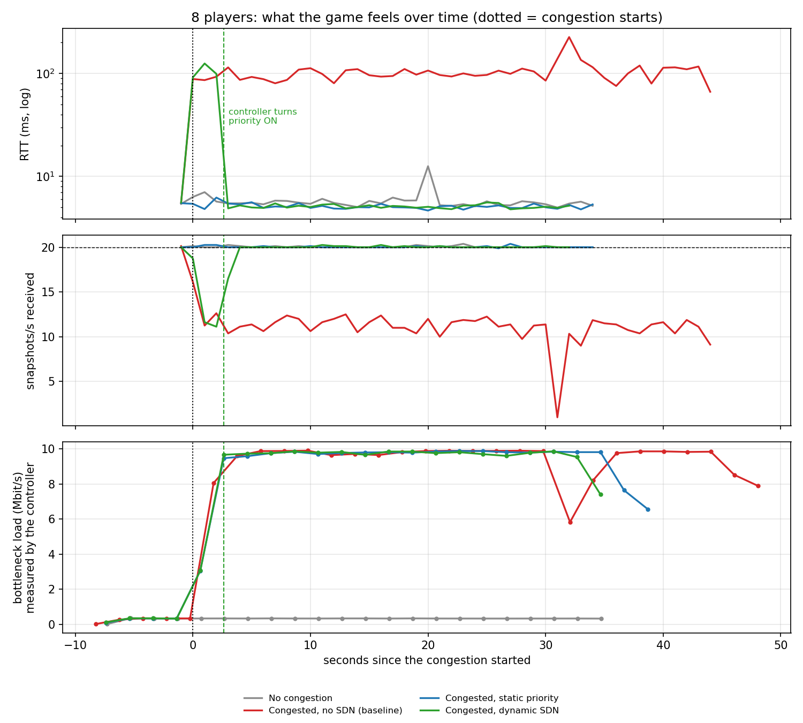
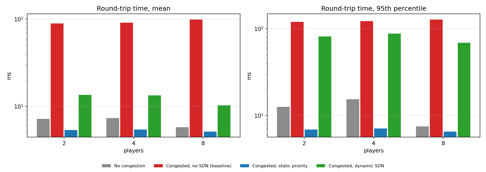

# Project 17 - Multiplayer racing game over UDP, with SDN congestion control

A racing game (UDP, authoritative server, 20 snapshots/s) that runs inside **Mininet**. A **Ryu / OpenFlow
controller** watches the bottleneck link and, when background traffic congests it, moves the game's UDP traffic
into a priority queue. The experiments compare **no SDN**, **static priority** and **dynamic SDN** under the same
congestion and measure latency, 95th-percentile latency, jitter, packet loss, snapshots/s and players lost.

| Role | Owner of | Files |
|---|---|---|
| 1 Game & UDP | game, protocol, server, clients | `app/server.py client.py game.py protocol.py track.py netclient.py`, `README_ROLE1.md`, `docs/PROTOCOL.md` |
| 2 Mininet & SDN | topology, QoS queues, Ryu controller | `topo/game_topo.py`, `controller/game_qos.py`, `scripts/setup_qos.sh`, `README_ROLE2.md` |
| **3 Integration, testing, performance** | `README_ROLE3.md`, `Role3_Guide.pdf` | `app/sdn_client.py`, `app/bot.py`, `scripts/check_env.sh`, `scripts/run_experiment.py`, `scripts/demo.py`, `analysis/`, `tools/fake_controller.py`, `tests/test_role3.py`, `results/`, `docs/ROLE3_TESTING_AND_DEMO.md` |

```
 players h2..hN (app.bot)                                        iperf gen ---> sink  (the congestion)
        |  UDP 5005                                                          |
       [ s2 ] ===== bottleneck 10 Mbit/s, OVS queues: q0 other / q1 game ===== [ s1 ] --- h1 game server (app.server)
                         ^   OpenFlow: set_queue:1 for registered players         |  POST /game/register  on every JOIN
                         |                                                        v       (app/sdn_client.py)
                         +---------------- Ryu controller (game_qos.py) <---- REST API 10.0.0.254:8080
                                           polls the port counters every 2 s: util >= 70 % -> priority ON
```

**How the game and the SDN are connected (the "Socket-SDN integration").** When a player's JOIN reaches the game
server, `app/sdn_client.py` calls the controller's REST API (`POST /game/register`, non-blocking, retried, logged to
`sdn_calls.csv`). Only registered players' UDP 5005 flows get the `set_queue:1` rule. A player leaving, timing out or
the server stopping unregisters it. So an *application event* changes the *network behaviour*.

---------------------------------------------------------------------------------------------------------

## Quick demo: two commands

```bash
sudo python3 scripts/demo.py --prepare            # once, on the Mininet VM: real measurements (about 15 minutes)
python3 scripts/demo.py                           # the demo itself: about 15 seconds, no root needed
sudo python3 scripts/demo.py --prepare --resume   # measure only the runs that are still missing, keep the rest
```

The demo command runs **23 named test cases** (TC01-TC23: UDP protocol, game server, packet loss, fault handling,
SDN integration) with Python's `unittest` and prints PASS / FAIL for each. It then prints the comparison table of the
measured runs in `results/runs` (every case for 2 / 4 / 8 players: RTT mean, p95, jitter, loss, snapshots/s, players
finished, controller reaction time, SDN check). Graphs are a separate command: `python3 analysis/plot.py` writes PNG
files into `results/plots`.

The same results are saved as spreadsheets on every run: **`results/project17_results.xlsx`** (opens in Excel or
LibreOffice Calc; sheets *Comparison*, *SDN vs No SDN* with the improvement as formulas, *Test cases*, *All runs*,
*Notes*) and the CSV files `results/comparison.csv`, `results/test_cases.csv` and `results/summary.csv`.
`python3 scripts/demo.py --excel` opens the workbook at the end. The workbook needs `openpyxl`
(`pip install openpyxl` or `sudo apt install python3-openpyxl`); the CSV files are written without it.

`--prepare` measures four cases for 2, 4 and 8 players: no congestion, congested without SDN, congested with static
priority, congested with dynamic SDN. Without `--resume` it measures every case again and replaces the old runs; with
`--resume` it keeps the finished runs. `--reps 3` adds repetitions (error bars in the graphs).
`sudo python3 scripts/demo.py --live` also measures one congested race with dynamic SDN on the spot (about 1 minute
more). That race is stored in `results/live` and printed as a note; it does not replace the prepared runs.

---------------------------------------------------------------------------------------------------------

## What you run, in order

Everything below is copy-paste. Steps 0, 1, 5 and 6 are for the Ubuntu VM with Mininet (5 and 6 need `sudo`).
Steps 2 to 4 need no Mininet and run on any machine with Python 3.9 or newer. Step 7 redraws the graphs from the files
in `results/runs` and needs only matplotlib.

### Step 0 - get the code and install (once, on the Ubuntu VM)

```bash
git clone <your-repo-url> project17 && cd project17
bash scripts/install_role2.sh            # Mininet, Open vSwitch, iperf, Ryu (in ~/ryu-env)  - takes a few minutes
pip install -r requirements-analysis.txt # matplotlib + openpyxl  (or: sudo apt install python3-matplotlib python3-openpyxl)
```

### Step 1 - is the machine ready?

```bash
sudo bash scripts/check_env.sh --tests
```
Every line must say `[ OK ]` (a `[warn]` is fine). It checks Mininet, Open vSwitch running, Ryu, iperf, free ports,
CPU cores and runs the 278 unit tests. Fix any `[FAIL]` using the arrow line under it.

### Step 2 - check the game itself (no network, no SDN)

```bash
python3 -m app.client --local            # a window: you + 3 autopilot opponents   (needs: pip install -r requirements.txt)
python3 -m app.client --local --net      # the same with the network panel; press F3 to toggle it
```
In the panel you read **RTT (now / avg / p95), jitter, loss, snapshots per second**. On one machine expect
RTT 3-6 ms, loss 0 %, 20 snapshots/s. Controls: W/A/S/D or arrows. (No window? see step 3.)

### Step 3 - check the delay numbers with headless bots (no Mininet needed)

```bash
python3 -m app.server --auto-start 4 --exit-after-races 1 --laps 1 --quiet &      # terminal 1 (or add & as shown)
python3 -m app.bot --server 127.0.0.1:5005 --bots 4 --prefix t- --out /tmp/try --label try
```
It prints one line per bot (`rtt 4.7 ms (p95 5.0) loss 0.00% jitter 1.9 ms snapshots 904`) and writes
`/tmp/try/t_bots.csv`, `t_timeline.csv`, `t_rtt.csv`. A race takes about 45 s.

### Step 4 - test the whole experiment pipeline without Mininet (optional, no root)

```bash
python3 scripts/run_experiment.py --backend local --players 4 --cases baseline --out /tmp/pipeline_test
python3 analysis/plot.py --runs /tmp/pipeline_test/runs --summary /tmp/pipeline_test/summary.csv --out /tmp/pipeline_test/plots --table /tmp/pipeline_test/table.md
```
This proves the scripts, the files and the graphs work on your machine. The loopback has **no bottleneck**, so the
numbers say nothing about SDN, and the graphs are stamped `LOCAL PIPELINE TEST` so they cannot end up in the report.
`python3 analysis/plot.py --demo` previews every figure with clearly fake data (stamped `SYNTHETIC`).

### Step 5 - look at the SDN by hand once (so you understand what the script automates)

Three terminals, all in the repo folder. **Never run `sudo mn -c` while Ryu runs.**

```bash
# terminal 1 - controller                       # terminal 2 - network (opens the Mininet CLI)
source ~/ryu-env/bin/activate                    #   sudo python3 topo/game_topo.py --players 4 --bw 10
ryu-manager controller/game_qos.py --ofp-tcp-listen-port 6653 --wsapi-port 8080
```
In the Mininet CLI of terminal 2:

```text
mininet> pingall                                             # 0 % dropped = the topology and the learning switch work
mininet> h1 curl -s http://10.0.0.254:8080/game/status       # the controller answers: mode, util, switches [1, 2]
mininet> h1 python3 -m app.server --auto-start 4 --exit-after-races 1 --laps 1 --sdn-url http://10.0.0.254:8080 --sdn-log results/manual_sdn.csv &
mininet> h2 python3 -m app.bot --server 10.0.0.1:5005 --bots 1 --prefix h2- --out results/manual --label manual &
mininet> h3 python3 -m app.bot --server 10.0.0.1:5005 --bots 1 --prefix h3- --out results/manual --label manual &
mininet> h4 python3 -m app.bot --server 10.0.0.1:5005 --bots 1 --prefix h4- --out results/manual --label manual &
mininet> h5 python3 -m app.bot --server 10.0.0.1:5005 --bots 1 --prefix h5- --out results/manual --label manual &
mininet> h1 curl -s http://10.0.0.254:8080/game/status       # "players" now lists 10.0.0.2 .. 10.0.0.5  <- the SDN integration
mininet> sink iperf -s -u -i 1 &
mininet> gen iperf -c 10.0.0.102 -u -b 20M -t 30 &           # congestion: 20 Mbit/s into a 10 Mbit/s link
mininet> h2 ping -c 15 10.0.0.1                              # ordinary traffic now sees ~120 ms (full queue 0)
mininet> sh sudo bash scripts/setup_qos.sh show              # "Sent ... pkt" grows on class 1:2 = game traffic in the priority queue
mininet> sh sudo ovs-ofctl -O OpenFlow13 dump-flows s1 | grep set_queue   # the rules the controller installed
mininet> sh tail -5 results/controller/events.csv            # priority_on ... priority_off  (the dynamic part)
```
Switch the policy at runtime and repeat the race to compare: `h1 curl -s -X POST -d '{"mode":"off"}' http://10.0.0.254:8080/game/mode`
(also `static`, `dynamic`).

### Step 6 - the automated experiments

```bash
sudo python3 scripts/run_experiment.py --dry-run                 # shows the plan and the time estimate, runs nothing
sudo python3 scripts/run_experiment.py --quick                   # 4 players, 3 cases, about 5 minutes: do this first
sudo python3 scripts/run_experiment.py                           # full matrix: 2, 4, 8 players x 4 cases, about 12 minutes
sudo python3 scripts/run_experiment.py --reps 3                  # three repetitions -> error bars in the graphs (about 45 minutes)
sudo python3 scripts/run_experiment.py --resume                  # skip the runs that already finished (after an interruption, or to add cases / repetitions)
```
Each run prints one summary line, for example
`congested_sdn_n8_r1: RTT mean 14 ms, p95 118 ms, loss 6 %, 18 snapshots/s, 0 players lost, reaction 2.4 s, SDN check: ok`.
`SDN check: FAILED (...)` means the switch counters did not show what the mode promises (see Troubleshooting).
By default (`--ryu auto`) the script starts and stops Ryu for every run, so close your own Ryu window first; use `--ryu external` if you want to keep your own Ryu running.
Useful options: `--iperf-rate 20` (Mbit/s of background load), `--queue 100` (bottleneck queue in packets, 100 = 120 ms),
`--bw 10`, `--delay 0`, `--laps 1`, `--match port` (prioritise all UDP 5005 without registration).

### Step 7 - graphs and tables

```bash
python3 analysis/plot.py                      # reads results/runs  ->  results/summary.csv, results/summary_table.md, results/plots/*.png
```

| File | What it shows |
|---|---|
| `fig_latency.png` | RTT mean and **95th percentile** vs 2/4/8 players, all cases |
| `fig_loss.png` | packet loss server->players (downlink) and players->server (uplink) |
| `fig_jitter.png` | jitter (mean, p95) |
| `fig_updates.png` | **snapshots/s** received (20 = healthy) and players that finished the race |
| `fig_timeline_nN.png` | RTT, snapshots/s and bottleneck load **over time**; dotted line = congestion starts, dashed = controller turns priority ON |
| `fig_cdf_nN.png` | distribution of the RTT |
| `summary_table.md` | tables for the report, "dynamic SDN vs no SDN" in numbers, SDN verification table |

---------------------------------------------------------------------------------------------------------

## Where every number comes from

| Metric | Measured by | File |
|---|---|---|
| RTT, p95 RTT | PING/PONG once a second per player, pooled over all players, **race window only** | `*_rtt.csv` |
| Jitter | RFC 3550 estimate at each player | `*_timeline.csv` |
| Snapshots/s | arrivals in the last second at each player, mean over the race | `*_timeline.csv` |
| Loss down | packet sequence numbers at the players (growth during the race) | `*_timeline.csv` |
| Loss up, uplink jitter | the server's own statistics | `server_stats.csv` |
| Players lost / timeouts | bots that lost the server for 5 s; server `PLAYER_LEAVE` timeouts | `*_bots.csv`, `server_events.csv` |
| Controller reaction time | first `priority_on` after the congestion started (dynamic only) | `controller/events.csv` |
| Evidence that SDN worked | packets in queue 1 and drops per queue after the race; `set_queue:1` rules counted mid-race | `verify.txt`, `flows_in_race.txt`, `meta.json` |
| Background traffic share | iperf receiver intervals | `iperf_sink.txt` |

**Two loss figures, on purpose.** Sequence-number loss cannot see a total blackout (nothing arrives, so no gap is
noticed). "Snapshots/s" can (a silent player counts as 0). Report both.

## Results

The measured runs, and everything derived from them, are in `results/`:

| Path | Content |
|---|---|
| `results/project17_results.xlsx` | **the results workbook**: Comparison (every case x 2 / 4 / 8 players), SDN vs No SDN (improvement as formulas), Test cases, All runs, Notes |
| `results/comparison.csv` | one row per case and player count, mean over the repetitions (the Comparison sheet as CSV) |
| `results/test_cases.csv` | TC01-TC23 with PASS / FAIL and the time taken |
| `results/summary_table.md` | per player count: every case side by side, dynamic SDN vs no SDN, dynamic vs static priority, and the SDN verification table |
| `results/plots/` | the figures listed in step 7 |
| `results/summary.csv` | one row per run with every metric |
| `results/runs/<case>_n<players>_r<rep>/` | the raw CSV files of each run and `meta.json` (parameters, exact commands, switch verification) |





How to read them:

* The delay **is the queue**: 100 packets x 1500 B at 10 Mbit/s = 120 ms (`--queue 100`, `--bw 10`). Without priority
  a game packet waits behind the background traffic in that queue, or is dropped when the queue is full.
* The game is light: about 24 kbit/s to each of 4 players and 52 kbit/s to each of 12, about 0.6 Mbit/s in total for
  12 players (`docs/HANDOVER_ROLES_2_3.md` section 1). It only suffers when something else fills the 10 Mbit/s link.
* **Dynamic vs static priority**: in static mode the priority rule exists from the moment a player registers, so there
  is no reaction time. In dynamic mode the controller notices the congestion at its next 2-second poll, so the first
  seconds of a congestion are unprotected: this is the `sdn_reaction_s` column, and it raises the 95th-percentile RTT.
  In return, dynamic mode leaves all traffic in the normal queue while the link is idle (`priority_on_pct`, and the
  optional case `idle_sdn`).
* Priority should not starve the background flow: compare `iperf_got_mbps` between the cases.
* Only the **downlink** is congested (iperf runs gen -> sink through s1's bottleneck port, the direction of the
  snapshots), so uplink loss stays near 0. That is a property of the test set-up.
* `tools/netns_lab.py` (`docs/HANDOVER_ROLES_2_3.md` section 6) repeats the comparison without Mininet, with Linux
  network namespaces and `tc`, as an independent cross-check.

## Troubleshooting

| Symptom | Cause / fix |
|---|---|
| `pingall` shows loss, or "the network is not working, no reply from ..." | Ryu not connected: `curl http://127.0.0.1:8080/game/status` must list `switches [1, 2]`. Stop an old Ryu: `sudo pkill -f "[r]yu-manager"` (the brackets keep the command from matching itself), then `sudo mn -c` (never while Ryu is needed) |
| `SDN check: FAILED ... static priority` | game packets never reached queue 1. Check `sdn_calls.csv` (registrations `ok=1`?), `ryu.log`, and `sudo bash scripts/setup_qos.sh show`. Quick test: `--match port` |
| `TCP port 6653/8080 is already in use` | an old Ryu is still running: `sudo pkill -f "[r]yu-manager"` |
| Everything slow / RTT high even in `baseline` | VM has 1 core or is overloaded; give it 2-4 cores; fewer players per run |
| A run says `0 snapshots/s`, `valid 0` in summary | bots never joined: open `h2_bot.log`, `server.log` in that run folder |
| `matplotlib is missing` | `pip install matplotlib` (CSV and table are still written) |
| Interrupted run left interfaces behind | `sudo mn -c` (with no Ryu running) |

## Tests

```bash
python3 -I -W error::ResourceWarning -m unittest discover -s tests -t .      # 278 tests, about 45 s
```
`tests/test_role3.py` covers the SDN client (retries, reference counting, a dead controller), the server's hook, the
recorder, the metrics (percentiles, iperf parsing, loss window), the verification logic, one **real local run** of the
whole pipeline, and the figures. Role 1's 247 tests still pass unchanged. `scripts/demo.py` runs 23 of them by name
as the demo's test cases.

## Status and limits

* **Unit tests**: 278 tests, no root and no Mininet needed (the 48 window tests are skipped when pygame is not
  installed). `tests/test_role3.py` also runs the whole experiment pipeline once on the loopback against
  `tools/fake_controller.py`.
* **Mininet experiments**: measured on an Ubuntu VM with Mininet, Open vSwitch and Ryu using
  `scripts/run_experiment.py`; the data is in `results/runs`. For every run, `meta.json` records whether the switch
  behaved the way the mode promises (`verify.ok`, from the queue counters and the `set_queue` flows of s1), and
  `results/summary_table.md` lists that check per case.
* **Limits of the evaluation**: one bottleneck link; congestion only in the server-to-player direction; the players
  are autopilot bots; one lap per run; the number of repetitions of each case is the `rep` column of
  `results/summary.csv`.
* Changes to Role 1's files are additive and optional: `server.py` (`--sdn-url`, `--sdn-log`, a `sdn=` parameter) and
  `netclient.run_bots` (`on_tick`). Without those options nothing behaves differently.
